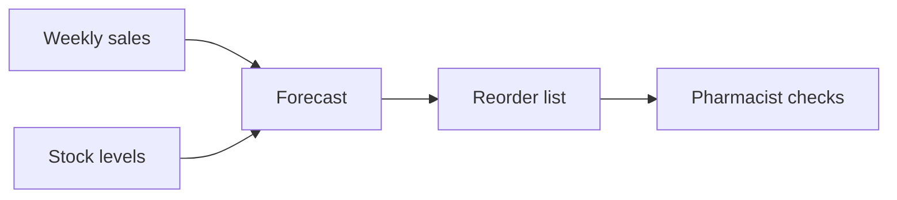

# Technical Writing for Data and AI Work

## Day 1: Writing for a reader

One reader, the bottom line first, and the documents a project needs before anyone else can use it

#### [day1#title] Writing for a reader

*SDAIA Academy · Technical Writing for Data and AI Work*

Day 1: One reader, the bottom line first, and the documents a project needs before anyone else can use it

Data & AI Foundations Track · 2 teaching days + capstone day · 3 sessions · 3 labs · FND-AIC-106

#### [day1#agenda] Writing for a reader

*Today*

- **Session 1 · Write for one reader**: Name the reader and the decision before choosing the document, then put the bottom line first
- **Session 2 · READMEs, designs and decisions**: Write what a stranger needs to install, run and check a project, and keep designs and decisions as text beside the code
- **Session 3 · The decision memo**: Turn a measured comparison into one page: options, trade-offs, a recommendation and what would change it

#### [day1#setup-check] Clone the course, open the labs folder and run the setup check

*Before the first lab*

- Clone the course repository, open a terminal in its `labs` folder.
- Run `uv run kit/setup_check.py`: uv fetches Python 3.11 or later if it is missing.
- You write every file of the day in `labs/work/`, which git ignores.
- No account, no key, no model download: the tools read and check text on your laptop.

- **What proves it works.** The last line reads `setup: ok`. Any line that starts with `missing:` names a file to fetch again.

### Session 1: Write for one reader

#### [day1#s1] Write for one reader

*Session 1*

- Name the reader, purpose and decision behind a request for a document
- Choose the document type and its required sections for a scenario
- Rewrite an update so the bottom line, the request and the uncertainty come first

#### [day1#reader-first] Name the reader and their decision before you pick a document

*Before you write*

- **Who reads?** One person, by role: the operations director, a new developer, the head of reception. "Everyone" is nobody.
- **What will they do?** Install, approve, choose, repeat, rely. The verb decides the document and its first line.
- **What do they know?** You know the project too well to see its gaps: write for what the reader already knows, not for you.

> **What goes wrong.** A document written for "the stakeholders" answers nobody's question and buries the one decision someone has to make.

#### [day1#five-documents] Five documents, five readers, five jobs

*Documents for data and AI work*

| Document | Its reader | The reader then | It cannot do without |
| --- | --- | --- | --- |
| README | A stranger to the project | installs, runs and checks it | exact commands and what success prints |
| Design document | An approver, before code | approves, changes or refuses | alternatives and risks |
| Decision memo | A decision maker | signs one option | trade-offs and what would change it |
| Experiment report | The team, now and later | repeats and compares | the setup and the uncertainty |
| Model or system card | A user of the system | decides how far to rely on it | intended use, slices, limits |

#### [day1#bluf-before-after] Put what the reader must do in the first two sentences

*Bottom line first*

- **As sent.** "Since the spring the pharmacy team has looked at several ways of forecasting reorders. We first tried a seasonal average, which was generally fine, then a boosted-tree model, which seems better on most weeks. ... So we would like to buy a quarter of model runs."
- **Bottom line first.** "Please approve SAR 46 for one quarter of weekly forecast runs with Method B. In 60 past weeks when a medicine ran out, it flagged 52 in advance; the current method flagged 41."

> **Test.** If the reader stopped after the first paragraph, could they act?

#### [day1#bluf-shape] Decision, then reasons, then detail, then next step

*The shape*

1. **1 · Bottom line** the request or the finding, with its size and date
2. **2 · Why** the two or three facts it rests on
3. **3 · Detail** method, numbers, caveats, for whoever reads on
4. **4 · Next** what happens after the reader acts

> **Headings help.** A reader who scans the headings alone should get the argument.

#### [day1#glossary] One term, one meaning, in both languages

*Arabic and English glossaries*

- A reader who meets **run-out**, **stock-out** and **shortage** wonders if they are three things.
- Agree the term once, with its Arabic pair and the words to avoid.
- Keep the glossary in the repository, beside the documents that use it.
- A checker can then flag every word to avoid, in every document.

| term_en | term_ar | avoid |
| --- | --- | --- |
| run-out | نفاد المخزون | stock-out; shortage |
| reorder | إعادة الطلب | top-up; refill |

#### [day1#uncertainty-in-words] Say how sure you are, and on how many cases

*Uncertainty in plain words*

- **Says nothing.** "Method B is significantly better at catching run-outs."
- **Says how sure.** "Method B flagged 52 of 60 past run-outs (0.87). With 60 cases, the 95% interval runs from 0.76 to 0.93."

- The count tells the reader how much evidence there is; the interval tells them how far to trust the rate.
- On nine cases, 7 of 9 (0.78) has an interval from 0.45 to 0.94: say so, or do not report the rate.

#### [day1#hedges] Replace a hedge with a number, a condition or "not measured"

*Hedges*

| Hedge | Replace with |
| --- | --- |
| "quite good", "generally fine" | the rate and its count: 41 of 60 |
| "seems better" | the difference, and whether the intervals overlap |
| "should be enough" | the condition: enough if at least 20 new cases are urgent |
| "no issues" | what was checked: 60 weeks, no missing values |
| "probably fine for other branches" | "not measured on other branches" |

> **"Not measured" is a finding.** It tells the reader where the evidence stops.

#### [day1#peer-review] Review against the rubric, the text and the reader, not the writer

*Rubric-based peer review*

- **Score each line.** 0, 1 or 2 against criteria written before anyone wrote: no overall impression.
- **Quote the words.** "Paragraph 2: 'quite well'": the writer can find it and fix it.
- **One strength, one change.** At least one of each, so the writer knows what to keep.

> **Read as the reader.** Pretend you are the operations director with two minutes, not a fellow writer with a red pen.

#### [day1#check-reader] Which document does this reader need?

*Checkpoint*

**Question:** The pharmacy team wants to add a second supplier feed to its forecast. Before anyone writes code, the finance manager must approve, change or refuse the plan, and wants to know what else was considered and what could go wrong.

- A. A README for the forecast repository and its feed
- B. A design document with alternatives and risks
- C. An experiment report on the new feed
- D. A system card for the forecast

#### [day1#lab-1-1] Bottom-line-first rewrite

Lab 1.1 · 60 min

Outline five documents for five readers, then rewrite the data team's status update bottom line first and check it

[D1_1_bluf.html](https://sdaiaacademy.github.io/fnd-aic-106/labs/D1_1_bluf.html)

- [ ] Read the five scenarios and name each reader's decision (8 min)
- [ ] Outline the five documents: reader, purpose, sections (17 min)
- [ ] Mark where the status update hides its bottom line (5 min)
- [ ] Rewrite it bottom line first, with glossary terms and uncertainty in words (20 min)
- [ ] Run the checker, then score a partner's rewrite with the rubric (10 min)
- [ ] ✱ Stretch: Write the first paragraph again in Arabic with the glossary's Arabic terms

#### [day1#debrief-1-1] The update as sent had its request in the last paragraph and 12 findings

*Lab 1.1 debrief*

- **Request last:** six hours of reception time appeared only in the closing paragraph.
- **Four drifts:** critical, emergency, catch rate and sensitivity, where the glossary says urgent and urgent recall.
- **Hedges:** "quite well", "significantly better", with numbers available.
- **Length:** 339 words, sentences of 24 words on average.

- **The uncertainty, stated.** 80 urgent messages left after the clean-up: on 80 cases a recall of 0.80 has a 95% interval from 0.70 to 0.87.

### Session 2: READMEs, designs and decisions

#### [day1#s2] READMEs, designs and decisions

*Session 2*

- Write install, run and check steps a stranger can follow on a clean machine
- Separate a README from a design document and a decision record
- Draw a pipeline as text that the repository renders

#### [day1#readme-job] A stranger installs, runs and checks the project without asking anyone

*A README's job*

- **Install.** Every command as typed, from which folder, with the versions it needs and any file to create.
- **Run.** The one command that does the project's job on supplied data, and where the output goes.
- **Check.** The tests, and the exact line they print when all is well: "it ran" is not "it works".

> **Then the rest.** What it is for and not for, where things are, its limits and its owner.

#### [day1#what-strangers-guess] A stranger stops at the steps the writer does without thinking

*What the writer forgets*

- **The language version** the code needs, and how to get it.
- **A file to create:** a settings file copied from an example, an empty folder.
- **The folder** a command runs from.
- **The real command,** when an old note names a script that no longer exists.
- **What success looks like:** the line a working run prints.

> **What goes wrong.** The writer tests the README on their own laptop, where every one of these is already true.

#### [day1#commands-exactly] Show the command and the line it must print

*Commands as typed*

````markdown
<!-- file: README.md -->
## Run

Forecast next week's reorders from the 60 sample weeks:

```sh
uv run python -m reorder forecast data/sample_weeks.csv
```

```text
forecast: 60 weeks read, 14 medicines flagged
```
````

> **The text block is a promise.** A reader, or a test, compares it with what the screen shows.

#### [day1#four-forms] A README points to the other kinds of documentation

*Not everything in one file*

- **Tutorial.** Learning by doing, step by step.
- **How-to guide.** One task, for someone who knows the basics.
- **Reference.** Every option and field, to look up.
- **Explanation.** Why it works the way it does.

> **The README is a front door:** install, run, check, then links to the rest.

#### [day1#design-document] A design document is written before the code, for the person who approves it

*Design document*

- **Summary:** the change and the decision asked for.
- **Problem and goals,** and what is out of scope.
- **The design,** with a diagram of what flows where.
- **Alternatives** and why not.
- **Risks** and failure cases, with what catches each.
- **Open questions,** reviewers and the approver.

- **Its test.** Could the approver say no for a good reason after reading it? If every alternative is a straw man, they cannot.

#### [day1#decision-record] A decision record keeps one decision and its reasons beside the code

*Decision record*

1. **Title** a short noun phrase
2. **Status** proposed, accepted, superseded
3. **Context** the forces, stated neutrally
4. **Decision** in a full, active sentence
5. **Consequences** good, bad and neutral

Numbered files in `docs/decisions/` become the project's decision log.

#### [day1#diagrams-as-text] A diagram written as text is reviewed and versioned like code

*Diagrams as text*

````markdown
<!-- file: README.md -->

````

- Mermaid and PlantUML turn short text into flowcharts and sequence diagrams.
- GitHub renders Mermaid blocks in Markdown.
- A change to the diagram shows in the diff, line by line.

#### [day1#clean-run] Follow your README on a fresh copy, exactly as written

*Test the README*

1. **1 · Fresh copy** no settings file, no environment
2. **2 · Literal** type only what is written
3. **3 · Log** each command, its result, each hesitation
4. **4 · Fix** the README, not the laptop

> **Two testers.** The kit's clean-run tool types exactly what you wrote; a partner shows you where a person hesitates.

#### [day1#check-readme] What did this README leave out?

*Checkpoint*

**Question:** A stranger follows the forecast's README on a fresh copy. The install step works, then the run command stops with "error: settings.toml not found". The writer's laptop runs it fine.

- A. A step that copies the example settings file
- B. A note that the stranger's laptop is misconfigured
- C. The command that runs the tests
- D. An offer to send the writer's own settings file

#### [day1#lab-1-2] Peer-tested README

Lab 1.2 · 60 min

Write the README of the undocumented urgency tagger, test it with a clean run, then have a partner follow it and log the run

[D1_2_readme.html](https://sdaiaacademy.github.io/fnd-aic-106/labs/D1_2_readme.html)

- [ ] Explore the repository and list what a stranger would have to guess (10 min)
- [ ] Write the install, run and check sections (20 min)
- [ ] Add the purpose, inputs and outputs, limits and a text diagram (10 min)
- [ ] Run the clean-run test on your README and fix what fails (10 min)
- [ ] Swap: a partner follows your README on a clean copy and writes the run log (10 min)
- [ ] ✱ Stretch: Start the README of your own project, the first part of the capstone

#### [day1#debrief-1-2] Four things a stranger had to guess in the tagger's repository

*Lab 1.2 debrief*

| Gap | What the stranger saw | The README line that closes it |
| --- | --- | --- |
| Settings file | `error: config.toml not found` | copy `config.example.toml` to `config.toml` |
| Python version | a TOML import error on an old Python | Python 3.11 or later; uv installs it |
| Stale note | `NOTES.txt` names `tagger.py`, which does not exist | say the note is out of date |
| Success | output with nothing to compare | `check: ok, 30 sample rows, 400 test rows, 2 recorded systems` |

### Session 3: The decision memo

#### [day1#s3] The decision memo

*Session 3*

- State the decision and the recommendation in the first two sentences
- Compare options on quality, cost and latency with numbers traced to the source
- Write the conditions under which the recommendation would change

#### [day1#memo-one-page] One decision, one page, one signature

*The decision memo*

- **1** decision, asked as a question
- **450** words at most: one page
- **3** roles named: author, reviewer, decider

> **The reader has ten minutes.** Everything that does not help them choose goes in an appendix or the experiment report.

#### [day1#memo-shape] Bottom line, options, trade-offs, recommendation, what would change it

*Five parts*

1. **Bottom line** the recommendation and the request
2. **Options** each one, named once
3. **Trade-offs** measured, with intervals
4. **Recommendation** argued from the reader's needs
5. **What would change it** conditions with numbers

#### [day1#options-honest] Keep the current way as an option, and name every option the same way throughout

*Options*

- **The status quo** is a real option with real costs: say what staying costs.
- **Same names, same order** in the options, the table and the recommendation.
- **No straw men:** an option nobody would pick wastes the reader's ten minutes.
- **Unmeasured options** go in "what would change this", not in the table.

> **What goes wrong.** "Method B", then "the new model", then "the ML option": the reader wonders if they are three things.

#### [day1#tradeoff-table] Put the options side by side on the measures the reader cares about

*Trade-offs*

| Pharmacy reorder forecast | Method A (current) | Method B |
| --- | --- | --- |
| Run-outs flagged in advance, of 60 | 41 · 0.68 (0.56 to 0.79) | 52 · 0.87 (0.76 to 0.93) |
| Cost a month, one run a week | SAR 0 | SAR 15.17 |
| Time a run | 1 minute | 14 minutes |

A parallel example, synthetic, from `labs/_tools/slide_examples.py`.

#### [day1#requirement-first] Argue from the reader's requirement, not from "the best score"

*Recommendation*

- **From the score.** "Method B is better on every quality measure, so we recommend it."
- **From the requirement.** "The pharmacy needs 0.80 of run-outs flagged within SAR 20 a month. Only Method B is likely to meet it, and it costs SAR 15.17."

> **Requirements first.** State each one with its number, then show which options meet it and how surely.

#### [day1#conditions] Name the lines that, once crossed, bring the decision back

*What would change this*

- **A measured threshold:** if a larger test puts Method B below 0.80, bring a new option.
- **A volume:** at SAR 3.50 a run, five runs a month fit the SAR 20 budget and a sixth breaks it; daily runs do not fit.
- **A price:** at SAR 4.62 a run, weekly runs cost SAR 20.02 a month and break it.

> **Show the working.** Each computed number gets one line: 20 / 3.50 = 5.71 runs.

#### [day1#trace-numbers] Every number in the memo traces to the evidence or to its working

*Every claim checked*

- Copy numbers from the evidence; never retype them from memory.
- Round once, the same way everywhere.
- A number you computed has its working beside it.
- The reviewer checks numbers before style.

- **The checker in the lab.** `kit/memocheck.py` lists every number that is in neither the comparison, the context nor a Working line.

#### [day1#check-memo] Which sentence belongs in the pharmacy memo?

*Checkpoint*

**Question:** The pharmacy needs at least 0.80 of run-outs flagged. Method B flagged 52 of 60, 0.87, with a 95% interval from 0.76 to 0.93.

- A. "Method B meets the 0.80 requirement."
- B. "Method B cannot be shown to meet 0.80, so we cannot recommend it."
- C. "Method B is significantly better than the current method."
- D. "Likely meets 0.80; its interval reaches down to 0.76."

#### [day1#lab-1-3] Decision memo

Lab 1.3 · 60 min

Write a one-page memo to the operations director on which tagger the reception desk should use, from the measured comparison

[D1_3_memo.html](https://sdaiaacademy.github.io/fnd-aic-106/labs/D1_3_memo.html)

- [ ] Read the context and the comparison; write the decision in one line (8 min)
- [ ] Write the bottom line and the three options (12 min)
- [ ] Write the trade-offs with numbers from the comparison and their intervals (15 min)
- [ ] Write the recommendation and the conditions that would change it (10 min)
- [ ] Run the checker; a partner scores your memo on the five-criterion rubric (15 min)
- [ ] ✱ Stretch: Write the same choice as a decision record under five headings

#### [day1#debrief-1-3] Only Model L likely meets reception's 0.90, and it fits the budget

*Lab 1.3 debrief*

| 400 test messages, 80 urgent | Keyword rules | Model S | Model L |
| --- | --- | --- | --- |
| Urgent recall (95% interval) | 0.66 (0.55 to 0.76) | 0.82 (0.73 to 0.89) | 0.94 (0.86 to 0.97) |
| A month at 9,000 messages | SAR 0 | SAR 72.18 | SAR 337.68 |
| 95% of tags within | under 0.01 s | 1.24 s | 5.59 s |

Synthetic case: Model S and Model L outputs are simulated and recorded; no model ran.

> **And what would change it:** a larger test below 0.90; 10,661 messages a month or more; tags slower than 10 s.

#### [day1#wrap-up] Three things to keep

*Day 1 · wrap-up*

- **The reader decides.** One reader, one action: the document type and its first sentence follow from them.
- **Test the README.** A fresh copy, followed literally, by a tool and by a person.
- **Numbers with their doubt.** A count, an interval and the line that would change your mind.

#### [day1#next] Tomorrow: a supervised memo, then reports, cards and assistants

*Next*

- **First hour:** a one-page memo with AI off, from a result handed out on paper, scored on the lab 1.3 rubric.
- **Bring your project:** a small data or code project of your own, or keep the tagger.
- **Keep your files:** today's README and memo are the start of your capstone set.
