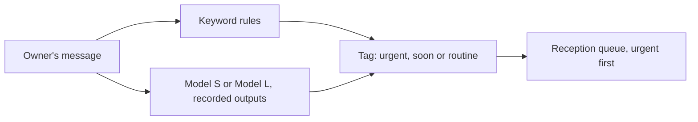

# Request urgency tagger

Tags owners' appointment messages as **urgent**, **soon** or **routine**, so that reception reads
the urgent ones first. It is a sorting aid for the reception queue of Tarthuth Veterinary Clinics
(a fictional case): a person still reads every message, and the tag never books or refuses a visit.

All data in this repository is synthetic. No key and no network access are needed: the keyword
rules run here, and the outputs of the two hosted models (Model S and Model L) are recorded files.

## Requirements

- Python 3.11 or later (uv installs it if it is missing)
- uv, the Python package and project manager

## Install

From the project folder, copy the example configuration. The tagger stops with
`error: config.toml not found` without it.

```sh
cp config.example.toml config.toml
```

## Run

Tag the 30 sample messages with the keyword rules. The tags are written to `out/tags.csv`.

```sh
uv run python -m urgency_tagger tag data/sample_requests.csv
```

```text
tagged 30 messages
wrote out/tags.csv
```

Measure a tagger on the 400-message test set: `--system` is `rules`, `model-s` or `model-l`.

```sh
uv run python -m urgency_tagger evaluate --system model-l
```

```text
system: model-l  test messages: 400
```

## Check

Run the tests and the data check. Both must end as shown.

```sh
uv run python -m unittest discover -s tests
uv run python -m urgency_tagger check
```

```text
check: ok, 30 sample rows, 400 test rows, 2 recorded systems
```

## How it works



| Path | What it holds |
|---|---|
| `urgency_tagger/` | The code: `rules.py`, `metrics.py`, `cli.py` |
| `data/sample_requests.csv` | 30 synthetic messages without tags |
| `data/test_set.csv` | 400 synthetic messages with the agreed tag |
| `data/recorded/` | The outputs of Model S and Model L on the test set |
| `config.example.toml` | Paths and the synthetic prices per 1,000 tokens |

`NOTES.txt` is from the first sprint and out of date: ignore its `python tagger.py` command.

## Limits

- The keyword rules miss urgent messages that use none of their words.
- The test set is small for rare kinds of message; see the model card before relying on a tag.

## Owner

The data team of the clinics. Report a problem to the data team lead.
